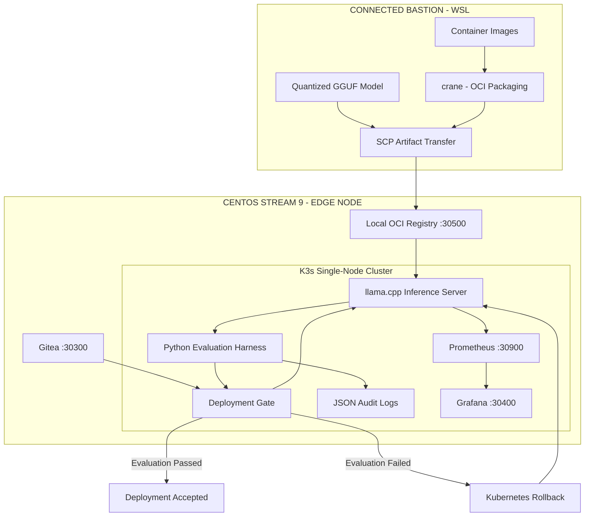
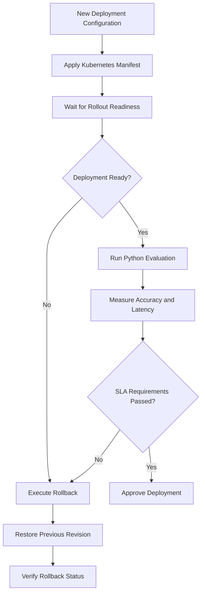

# Sovereign Edge

### Air-Gapped LLM Serving | Evaluation-Gated Deployments | Edge Observability

An end-to-end MLOps platform for deploying, evaluating, monitoring, and rolling back quantized Large Language Models in disconnected and resource-constrained edge environments.


---

## 1. Project Overview

Deploying an LLM in a conventional cloud environment is relatively straightforward. Operating one in a disconnected, resource-constrained environment introduces a different set of engineering challenges.

Model artifacts must be transferred securely. Container images must be available without depending on public registries. Inference resources must be controlled. Deployments must be evaluated before being accepted, and failures must be detected and recovered from without relying on external cloud services.

**Sovereign Edge** is a hands-on implementation of this operational architecture.

The project simulates a sovereign AI deployment environment using:

- A connected WSL machine acting as the artifact staging/bastion environment.
- A CentOS Stream 9 virtual machine running a single-node K3s cluster.
- A local OCI container registry for distributing pre-packaged container images.
- Self-hosted Gitea for storing Kubernetes manifests.
- llama.cpp serving a quantized Qwen2.5-1.5B-Instruct model.
- A custom Python evaluation harness for validating model deployments.
- Automated Kubernetes rollback when deployment or evaluation checks fail.
- Prometheus and Grafana for inference telemetry and alert visibility.

The objective is to demonstrate the operational lifecycle of an LLM beyond the conventional cloud environment, with an emphasis on reliability, resource efficiency, observability, and deployment control.

## 2. Key Engineering Highlights

| Capability | Implementation |
|---|---|
| Air-gap artifact delivery | crane, SCP, local OCI registry |
| Edge orchestration | K3s on CentOS Stream 9 |
| Model serving | llama.cpp HTTP server |
| Model quantization | Qwen2.5-1.5B-Instruct, Q4_K_M GGUF |
| Local GitOps source | Self-hosted Gitea |
| Deployment configuration | Kubernetes YAML manifests |
| Evaluation pipeline | Custom Python golden-set harness |
| Deployment gate | Accuracy and latency SLA validation |
| Automated recovery | Kubernetes rollout undo |
| Observability | Prometheus and Grafana |
| Alert rules | Queue saturation and throughput degradation |
| Auditability | Structured JSON evaluation logs |
| Operational documentation | Field incident runbook |

## 3. System Architecture

The architecture separates artifact preparation from edge execution.

The connected WSL environment prepares the model and container images. These artifacts are transferred to the CentOS edge VM, where the local registry and K3s cluster provide the runtime infrastructure.

### High-Level Architecture



### Deployment Lifecycle

1. **Artifact preparation:** Download quantized model weights and required OCI images on the connected WSL machine.
2. **Artifact transfer:** Package container images using crane and transfer the required artifacts to the CentOS edge VM.
3. **Local artifact distribution:** Import and publish container images into the locally hosted OCI registry.
4. **Model deployment:** Deploy llama.cpp and the quantized GGUF model through Kubernetes manifests.
5. **Configuration management:** Maintain deployment manifests in the local Gitea repository.
6. **Evaluation:** Run a Python-based golden test suite against the live inference endpoint.
7. **Deployment decision:** Accept or reject the rollout according to accuracy and latency thresholds.
8. **Recovery:** Trigger Kubernetes rollback if the readiness or evaluation gate fails.
9. **Observability:** Collect inference metrics through Prometheus and visualize them in Grafana.

**Important:** This is a Git-backed deployment workflow using a local source of truth and an explicit deployment script. It does not currently use an automatic Argo CD reconciliation controller.

---

## 4. Infrastructure and Technology Stack

### Edge Infrastructure

| Component | Configuration |
|---|---|
| Virtualization | VMware Workstation |
| Operating System | CentOS Stream 9 |
| Kubernetes Distribution | K3s |
| CPU | 4 vCPU |
| Memory | 8 GB RAM |
| Compute Type | CPU-only |
| Cluster Type | Single-node |
| Model Storage | Local persistent host directory |

### Application and Infrastructure Stack

| Layer | Technology |
|---|---|
| Operating System | CentOS Stream 9 |
| Orchestration | K3s |
| Container Runtime | containerd |
| Artifact Packaging | crane |
| Container Registry | Docker Registry |
| Local Git Server | Gitea |
| Model Serving | llama.cpp |
| Model | Qwen2.5-1.5B-Instruct |
| Model Format | GGUF |
| Quantization | Q4_K_M |
| Deployment Configuration | Kubernetes YAML |
| Evaluation | Python |
| Automation | Bash |
| Monitoring | Prometheus |
| Visualization | Grafana |

---

## 5. Air-Gapped Artifact Distribution

One of the central challenges of operating AI infrastructure in disconnected environments is ensuring that the target environment does not depend on public container registries or external model repositories during deployment.

This project implements a bastion-to-edge artifact distribution workflow.

### Workflow

**Connected Bastion (WSL)**

- Download required container images.
- Package images as OCI-compatible archives using crane.
- Download the quantized GGUF model.
- Transfer artifacts to the CentOS VM using SCP.

**Edge Environment (CentOS Stream 9)**

- Import the required bootstrap image.
- Deploy the local Docker Registry.
- Publish application images into the registry.
- Configure K3s to trust the local registry.
- Deploy workloads using locally available container images.

### Local Artifact Registry

The local registry is exposed through:

```text
http://<EDGE-NODE-IP>:30500
```

Example registry catalog:

```json
{
  "repositories": [
    "gitea",
    "grafana",
    "llama-server",
    "prometheus"
  ]
}
```

The registry allows the edge deployment to use locally distributed images rather than pulling application images directly from Docker Hub or GHCR.

> The project demonstrates an air-gap-oriented artifact staging workflow. Full network isolation and blocked external egress should be independently tested before describing the environment as a verified physically disconnected deployment.

---

## 6. Quantized LLM Serving

The inference layer uses llama.cpp to serve a quantized Qwen2.5-1.5B-Instruct model.

Instead of requiring GPU infrastructure, the project runs inference on a CPU-only virtual machine with limited resources.

### Model Configuration

| Parameter | Value |
|---|---|
| Model | Qwen2.5-1.5B-Instruct |
| Model Format | GGUF |
| Quantization | Q4_K_M |
| Inference Engine | llama.cpp |
| Execution | CPU-only |
| CPU Threads | 4 |
| Context Window | 2,048 tokens |
| Server Port | 8080 inside container |
| Kubernetes NodePort | 30800 |
| Memory Request | 1,200 MiB |
| Memory Limit | 2,200 MiB |
| CPU Request | 1 CPU |
| CPU Limit | 3.5 CPU |

### Kubernetes Deployment

The inference deployment is maintained in:

```text
manifests/llm-serving.yaml
```

The model is mounted from the host directory:

```text
/opt/sovereign-models
```

The container receives the model through a read-only volume mount.

The llama.cpp server exposes:

- `/health` for application health checks.
- `/v1/chat/completions` for OpenAI-compatible inference requests.
- `/metrics` for Prometheus-compatible telemetry.

### Test Inference

```bash
curl -s http://localhost:30800/v1/chat/completions \
  -H "Content-Type: application/json" \
  -d '{
    "model": "qwen2.5-1.5b",
    "messages": [
      {
        "role": "user",
        "content": "Explain three priorities for reliable sovereign AI infrastructure."
      }
    ],
    "max_tokens": 100,
    "temperature": 0.2
  }'
```

---

## 7. Evaluation-Gated Deployment Pipeline

Deploying a new model version without validating its behaviour can introduce performance regressions or incorrect outputs.

To address this, the project implements a custom Python evaluation harness and a deployment wrapper.

### Evaluation Harness

File:

```text
harnesses/eval_gate.py
```

The harness sends four deterministic test prompts to the live inference endpoint.

| Test ID | Evaluation Objective | Expected Response |
|---|---|---|
| airgap-net-01 | SSH protocol and port validation | SSH |
| k8s-ops-02 | Kubernetes workload knowledge | Pod |
| india-sov-03 | Basic geographical knowledge | New Delhi / Delhi |
| quant-ml-04 | Quantization and memory efficiency | Decrease |

The script:

1. Sends test requests to the deployed model.
2. Measures individual inference latency.
3. Validates responses against expected keywords.
4. Calculates the overall test pass rate.
5. Calculates average request latency.
6. Estimates completion-token throughput across the test run.
7. Collects llama.cpp telemetry.
8. Generates a structured JSON audit record.
9. Returns an exit code according to the evaluation verdict.

### Configurable Deployment SLAs

| Evaluation Metric | Threshold |
|---|---:|
| Minimum Golden Set Accuracy | 75% |
| Maximum Average Request Latency | 8 seconds |
| Kubernetes Deployment Readiness | Required |

These thresholds are configurable in the evaluation script.

### Automated Deployment and Rollback

File:

```text
harnesses/deploy_with_gate.sh
```

The deployment wrapper follows three main stages:

**Stage 1 — Apply Kubernetes Configuration**

```bash
kubectl apply -f manifests/llm-serving.yaml
```

**Stage 2 — Verify Deployment Readiness**

```bash
kubectl rollout status deployment/qwen-edge-llm \
  -n sovereign-ai --timeout=90s
```

**Stage 3 — Execute the Evaluation Gate**

```bash
python3 harnesses/eval_gate.py
```

When the deployment passes the configured accuracy and latency SLAs, it is accepted.

When the deployment fails readiness or evaluation checks, the wrapper attempts to restore the previous Kubernetes Deployment revision:

```bash
kubectl rollout undo deployment/qwen-edge-llm \
  -n sovereign-ai
```

The rollback path depends on a previous Deployment revision being available.

### Deployment Gate Flow



### Evaluation Audit Logging

Every evaluation run generates a structured audit record at:

```text
audit-logs/latest_eval_audit.json
```

The audit record contains:

- UTC timestamp.
- Evaluation verdict.
- Accuracy score.
- Average inference latency.
- Completion-token throughput.
- Configured SLA thresholds.
- Captured Prometheus telemetry.
- Individual test results and outputs.

This provides a persistent record of the evaluation decision rather than relying only on terminal output.

---

## 8. Performance Measurements

The project was tested on a CPU-only CentOS Stream 9 virtual machine with 4 vCPU and 8 GB RAM.

### Recorded Evaluation Audit

The committed evaluation record contains the following results:

| Metric | Recorded Value |
|---|---:|
| Golden Test Cases Passed | 4 / 4 |
| Golden Set Accuracy | 100% |
| Average Request Latency | 0.595 seconds |
| Evaluation Throughput | 4.20 tokens/second |
| Configured Maximum Latency | 8.0 seconds |
| Configured Minimum Accuracy | 75% |
| Gate Verdict | APPROVED |

### Additional Runtime Telemetry

The Grafana dashboard screenshot captures a separate live runtime sample showing:

| Metric | Screenshot Value |
|---|---:|
| Generation Speed | 20.8 tokens/sec |
| Prompt Prefill Speed | 38.7 tokens/sec |
| Cumulative Tokens Generated | Increasing during the observation window |

These figures are point-in-time dashboard readings, not fixed benchmark guarantees. They represent a separate runtime observation from the committed evaluation audit.

Actual performance depends on CPU load, prompt size, context length, and inference workload.

---

## 9. Prometheus and Grafana Observability

Model inference infrastructure needs visibility into throughput, request queues, and runtime behaviour.

The project deploys Prometheus and Grafana directly inside the K3s environment using locally available container images.

### Prometheus

Prometheus is configured to scrape the llama.cpp metrics endpoint every five seconds.

Configuration:

```text
manifests/observability-stack.yaml
```

Target:

```text
qwen-edge-llm.sovereign-ai.svc.cluster.local:8080
```

Metrics collected include:

| Metric | Description |
|---|---|
| `llamacpp:prompt_tokens_total` | Total prompt tokens processed |
| `llamacpp:tokens_predicted_total` | Total generated tokens |
| `llamacpp:prompt_seconds_total` | Time spent processing prompts |
| `llamacpp:tokens_predicted_seconds_total` | Time spent generating tokens |
| `llamacpp:requests_processing` | Requests currently processing |
| `llamacpp:requests_deferred` | Requests waiting for processing |
| `llamacpp:predicted_tokens_seconds` | Generation throughput |

### Grafana Dashboard

Grafana is configured with an automatically provisioned dashboard:

**Sovereign AI - Edge LLM Telemetry**

The dashboard contains four panels:

1. Generation Speed (Tokens / Sec)
2. Prompt Prefill Speed (Tokens / Sec)
3. Cumulative Tokens Generated
4. Active vs Deferred Requests

The dashboard helps identify performance changes and potential inference bottlenecks.

### Alert Rules

Two custom Prometheus alert rules are configured.

| Alert | Trigger Condition | Duration | Severity |
|---|---|---|---|
| LLMQueueSaturation | Deferred requests greater than zero | 15 seconds | Critical |
| LLMThroughputDegraded | Generation throughput below 5 tokens/sec and greater than zero | 30 seconds | Warning |

These rules provide alert-state evaluation within Prometheus. Alert notification delivery through Alertmanager is not currently part of this implementation.

---

## 10. Operational Incident Runbook

A monitoring system is useful only when engineers can act on the signals it provides.

The project includes a field incident runbook:

```text
runbooks/FIELD_INCIDENT_RUNBOOK.md
```

It provides operational commands and troubleshooting procedures for common inference incidents.

### Incident A — High Latency or Queue Saturation

**Symptoms**

- Deferred requests increase.
- Generation throughput decreases.
- Inference requests experience higher latency.

**Initial investigation**

```bash
curl -s http://localhost:30800/metrics \
  | grep -E "llamacpp:(requests_processing|requests_deferred)"
```

The runbook directs the operator to inspect request pressure and use the evaluation-gated deployment workflow where appropriate.

### Incident B — Pod OOMKilled

**Symptoms**

- Pod enters CrashLoopBackOff.
- Kubernetes reports OOMKilled.
- The container exits with code 137.

**Initial investigation**

```bash
kubectl describe pod \
  -l app=qwen-edge-llm \
  -n sovereign-ai
```

**Remediation**

Review the context-window configuration and available memory. If necessary, reduce the configured context size and redeploy through the evaluation gate.

### Incident C — Failed Model Evaluation

**Symptoms**

- Accuracy falls below the required threshold.
- Average latency exceeds the configured SLA.
- Evaluation verdict becomes REJECTED.

**Recovery**

```bash
kubectl rollout undo deployment/qwen-edge-llm \
  -n sovereign-ai

kubectl rollout status deployment/qwen-edge-llm \
  -n sovereign-ai

python3 harnesses/eval_gate.py
```

The automated rollback wrapper attempts the same recovery operation when the gate rejects a deployment and a previous revision is available.

---

## 11. Repository Structure

```text
Sovereign-LLMOps-/
│
├── audit-logs/
│   └── latest_eval_audit.json
│
├── harnesses/
│   ├── eval_gate.py
│   └── deploy_with_gate.sh
│
├── manifests/
│   ├── llm-serving.yaml
│   └── observability-stack.yaml
│
├── runbooks/
│   └── FIELD_INCIDENT_RUNBOOK.md
│
├── docs/
│   └── images/
│       ├── grafana-dashboard.png
│       ├── gitea-repository.png
│       ├── prometheus-targets.png
│       └── prometheus-alerts.png
│
├── .gitignore
└── README.md
```

### Directory Responsibilities

| Directory | Responsibility |
|---|---|
| `audit-logs/` | Persistent evaluation results |
| `harnesses/` | Evaluation and deployment automation |
| `manifests/` | Kubernetes workload and observability configuration |
| `runbooks/` | Field troubleshooting procedures |
| `docs/images/` | Project screenshots and visual evidence |

Large model weights, container image archives, and sensitive infrastructure files are intentionally excluded from the Git repository through `.gitignore`.

---

## 12. Getting Started

This repository contains the Kubernetes manifests, automation scripts, evaluation harness, audit example, and incident runbook.

The model weights and container archives are not included. The following instructions assume that the edge VM and its local artifact infrastructure have already been prepared.

### Prerequisites

- CentOS Stream 9 edge VM.
- Working K3s cluster and `kubectl` configuration.
- Python 3.
- Local OCI registry populated with the required images.
- Qwen2.5-1.5B-Instruct GGUF model stored under `/opt/sovereign-models`.
- Local Gitea repository containing the deployment manifests.
- The required services reachable from the administrative shell.

### Clone the Repository

```bash
git clone https://github.com/AyaanShaheer/Sovereign-LLMOps-.git

cd Sovereign-LLMOps-
```

### Verify Kubernetes

```bash
kubectl get nodes -o wide

kubectl get pods -A
```

### Verify Model Health

```bash
curl -s http://localhost:30800/health
```

### Send an Inference Request

```bash
curl -s http://localhost:30800/v1/chat/completions \
  -H "Content-Type: application/json" \
  -d '{
    "model": "qwen2.5-1.5b",
    "messages": [
      {
        "role": "user",
        "content": "What is the role of Kubernetes in edge AI deployment?"
      }
    ],
    "max_tokens": 100,
    "temperature": 0.2
  }'
```

### Run the Evaluation Harness

```bash
python3 harnesses/eval_gate.py
```

### Execute Evaluation-Gated Deployment

```bash
chmod +x harnesses/deploy_with_gate.sh

./harnesses/deploy_with_gate.sh
```

### Verify Prometheus Targets

```bash
curl -s http://localhost:30900/api/v1/targets
```

### Verify Grafana Dashboard

```bash
curl -s http://localhost:30400/api/search
```

### Access the Services

| Service | Port | Purpose |
|---|---:|---|
| Local Registry | 30500 | OCI image distribution |
| Gitea | 30300 | Local Git hosting |
| Grafana | 30400 | Observability dashboard |
| Prometheus | 30900 | Metrics and alert rules |
| LLM Inference | 30800 | Model serving API |

Replace `localhost` with the reachable edge VM address when connecting from another machine. Alternatively, use the SSH port forwarding configured for the lab.

---

## 13. Screenshots and Implementation Evidence

The following screenshots demonstrate the project running in the local environment.

### Grafana — Live Edge LLM Telemetry

The dashboard visualises model generation throughput, prompt prefill speed, cumulative generated tokens, and active/deferred requests.


### Gitea — Local GitOps Repository

The self-hosted Gitea repository stores Kubernetes deployment configuration and operational artifacts within the edge environment.


### Prometheus — Scrape Target Health

The Prometheus target page shows the LLM metrics endpoint successfully reporting an UP state.


### Prometheus — Alert Rules

The alert page shows the configured LLMQueueSaturation and LLMThroughputDegraded alert rules.

Inactive status means the corresponding firing conditions were not currently met when the screenshot was captured.


---

## 14. Security and Deployment Considerations

This project is a lab/reference implementation demonstrating sovereign-style edge MLOps practices. It is not a production-certified defence deployment.

Before using the architecture outside an isolated lab:

- Replace demo credentials with Kubernetes Secrets or an approved secrets-management solution.
- Remove hard-coded Grafana credentials from manifests.
- Disable anonymous Grafana Admin access.
- Restrict NodePort access to authorised systems.
- Implement TLS and authenticated access where appropriate.
- Apply network policies and firewall rules to enforce the intended trust boundary.
- Verify actual network-egress restrictions before claiming complete air-gap isolation.
- Validate image provenance and integrity before importing artifacts.
- Introduce stronger model-quality evaluation beyond the current four keyword-based smoke tests.
- Add alert notification delivery and incident escalation where required.

**Never commit real passwords, private keys, access tokens, kubeconfig files, or production credentials to the repository.**

---

## 15. Future Improvements

Potential extensions to this implementation include:

- Argo CD for continuous GitOps reconciliation.
- Model versioning and artifact lineage with DVC.
- More comprehensive evaluation using domain-specific golden datasets.
- Shadow and canary deployments for model updates.
- Model-quality and output-regression monitoring.
- Alertmanager integration for operational notifications.
- Network isolation testing and hardened artifact provenance.
- GPU-backed inference and heterogeneous edge hardware support.
- Authentication, TLS, and role-based access control for internal services.

---

## 16. Why Sovereign Edge?

Sovereign Edge explores a part of AI engineering that extends beyond training and deploying a model.

It focuses on the infrastructure and operational controls required to keep an LLM usable in constrained environments:

- How do you distribute model artifacts without relying on public registries?
- How do you serve quantized LLMs on limited CPU and memory resources?
- How do you validate a new deployment before accepting it?
- How do you recover when an evaluation fails?
- How do you monitor inference throughput and request pressure?
- How do you provide field engineers with actionable troubleshooting procedures?

The project brings these concerns together into a reproducible edge MLOps lab using open-source infrastructure.

---

<p align="center">

### Built by Ayaan Shaheer

**MLOps | LLMOps | DevOps | AI Infrastructure**

[GitHub](https://github.com/AyaanShaheer) · [Project Repository](https://github.com/AyaanShaheer/Sovereign-LLMOps-)

</p>
